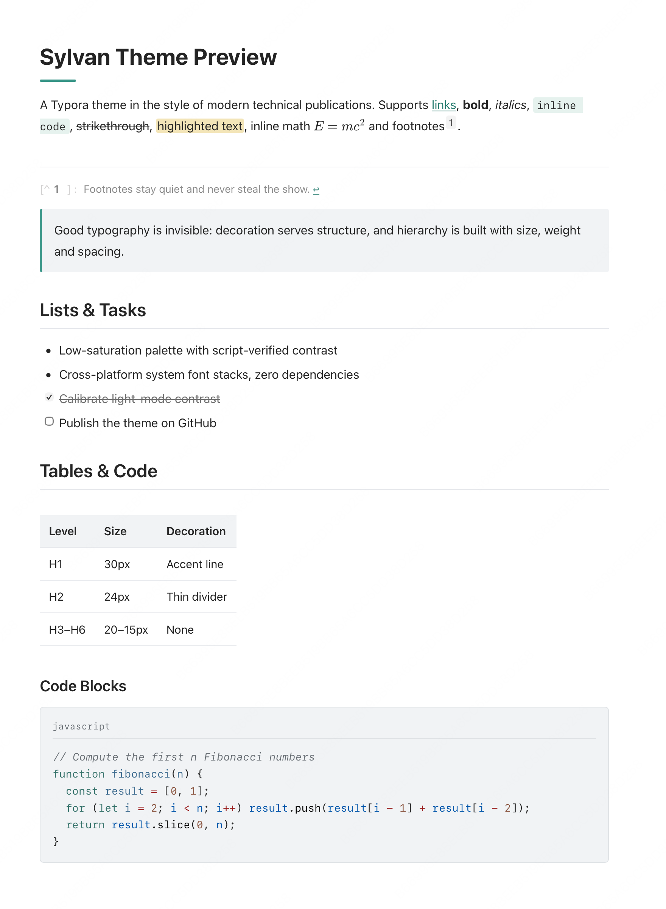

# Sylvan — Typora Theme

**English** | [简体中文](README_CN.md)

A Typora theme in the style of modern technical publications — the precision of technical docs with the reading comfort of a printed page. A single pure-CSS file: no bundled fonts, no assets to install.

  [](LICENSE)



*Light mode — the default look: quiet surfaces, an accent line under H1 and a language-labelled code block.*

## Features

- **Reading-first typography** — 16px body text, 1.75 line height, 800px measure. Hierarchy is built with size, weight and spacing, not decoration.
- **Heading system** — H1 carries a short rounded accent line, H2 a subtle gray divider, H3–H6 stay purely typographic.
- **Light & dark** — dark mode is an independently calibrated semantic mapping (not an inversion), following your OS appearance via `prefers-color-scheme`. All color pairs are verified with a WCAG contrast script (≥ 4.5:1 for body text, ≥ 3:1 for large text).
- **Code blocks** — neutral low-saturation syntax highlighting, a language label in the top-left corner (shown only when a language is set), themed thin scrollbars, horizontal scrolling for long lines, and full-height expansion in the editor (no inner vertical scroll).
- **Complete element coverage** — tables, task lists, blockquotes, footnotes, KaTeX math, Mermaid diagrams, images, and print / PDF export styles.
- **Zero dependencies** — system font stacks only (macOS / Windows / Linux each use their native UI + CJK fonts), nothing to download or install.

## Installation

1. Open Typora, go to **Preferences → Appearance → Open Theme Folder**.
2. Copy `sylvan.css` into that folder.
3. Restart Typora and select **Sylvan** from the **Theme** menu.

### Dark mode

Sylvan's dark styles activate automatically when your OS switches to dark mode (Typora 1.x). Precondition: in **Preferences → Appearance**, keep the dark theme setting compatible — the simplest way is to select Sylvan for both light and dark theme slots.

## Customization

All colors and layout metrics are CSS variables at the top of `:root` (light) and `html[data-color-scheme='dark']` (dark). Change one line to re-skin the theme:

```css
--accent-color: #399688;   /* accent */
--content-width: 800px;    /* measure */
```

> Note: link color is contrast-constrained — body-size text must keep ≥ 4.5:1 against its background. If you change the accent color, recalibrate `--link-color` accordingly.

## Compatibility

- Written against Typora's real DOM (`#write`, `pre.md-fences`, the CodeMirror editor state, `.code-tooltip`, export HTML), so both the editing view and exported HTML/PDF are styled.
- Print styles rely on Typora's export pipeline; page-break behavior may vary slightly between versions.

## License

Released under the [MIT License](LICENSE). You are free to use, modify and redistribute it — attribution is appreciated but not required.

If this theme helped you, a star on [github.com/oddyti/sylvan](https://github.com/oddyti/sylvan) is always welcome.
