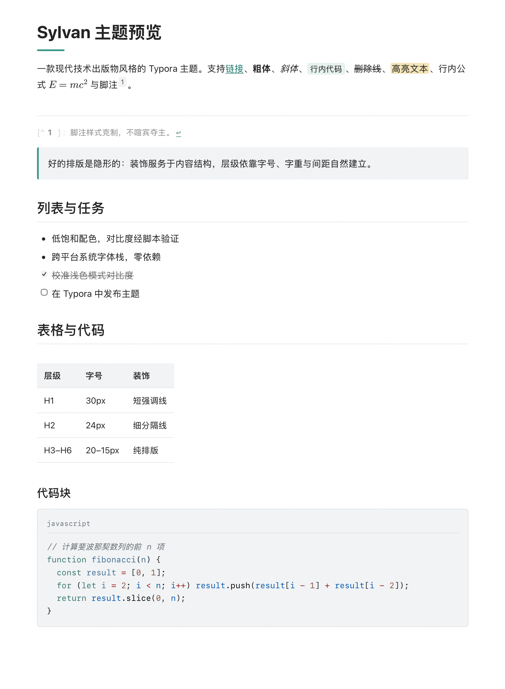

# Sylvan — Typora 主题

[English](README.md) | **简体中文**

现代技术出版物风格的 Typora 主题——技术文档的精确性，加上出版物的阅读体验。纯 CSS 单文件：不打包字体，无需安装任何资源。

  [](LICENSE)



*浅色模式——默认外观：克制的底色、H1 下的强调短线、带语言标签的代码块。*

## 特性

- **阅读优先的排版**：正文 16px、行高 1.75、行宽 800px，层级靠字号、字重和间距建立，不依赖装饰。
- **标题体系**：H1 下方青绿短强调线（圆角端点），H2 下方浅灰细分隔线，H3–H6 保持纯排版。
- **浅色 / 深色双模式**：深色模式是独立校准的语义映射而非简单反转，通过 `prefers-color-scheme` 跟随系统外观。全部颜色组合均经 WCAG 对比度脚本验证（正文小字 ≥ 4.5:1，大字号 ≥ 3:1）。
- **代码块**：中性低饱和语法高亮，顶部左侧语言标签（有语言时才显示），细条主题化滚动条，超宽行横向滚动，编辑态完整展开不内部滚动。
- **完整元素覆盖**：表格、任务列表、引用块、脚注、KaTeX 公式、Mermaid 图表、图片，以及打印 / PDF 导出样式。
- **零依赖**：只用系统字体栈（macOS / Windows / Linux 各自的原生 UI 与中文字体），没有需要下载安装的东西。

## 安装

1. 打开 Typora，进入 **偏好设置 → 外观 → 打开主题文件夹**；
2. 将 `sylvan.css` 复制到该目录；
3. 重启 Typora，在菜单栏 **主题** 中选择 **Sylvan**。

### 深色模式

系统切到深色外观时（需要 Typora 1.x），Sylvan 的深色样式会自动生效。前提：**偏好设置 → 外观** 中明暗主题槽位都选择 Sylvan 即可。

## 自定义

全部颜色与排版参数集中在 `:root`（浅色）与 `html[data-color-scheme='dark']`（深色）的 CSS 变量中，改一行即可换肤：

```css
--accent-color: #399688;   /* 强调色 */
--content-width: 800px;    /* 行宽 */
```

> 注意：链接颜色有对比度约束——正文小字必须与背景保持 ≥ 4.5:1。若修改强调色，请同步校准 `--link-color`。

## 兼容性

- 按 Typora 实际 DOM 编写（`#write`、`pre.md-fences`、CodeMirror 编辑态、`.code-tooltip`、导出 HTML），编辑视图与导出 HTML / PDF 均已适配。
- 打印样式基于 Typora 导出链路的通用分页规则，不同版本的分页表现可能略有差异。

## 许可证

本项目基于 [MIT 许可证](LICENSE) 发布。你可以自由使用、修改和再分发，不要求署名（如能保留一份来源说明会更好）。

如果这个主题对你有帮助，欢迎去 [github.com/oddyti/sylvan](https://github.com/oddyti/sylvan) 点个 Star。
